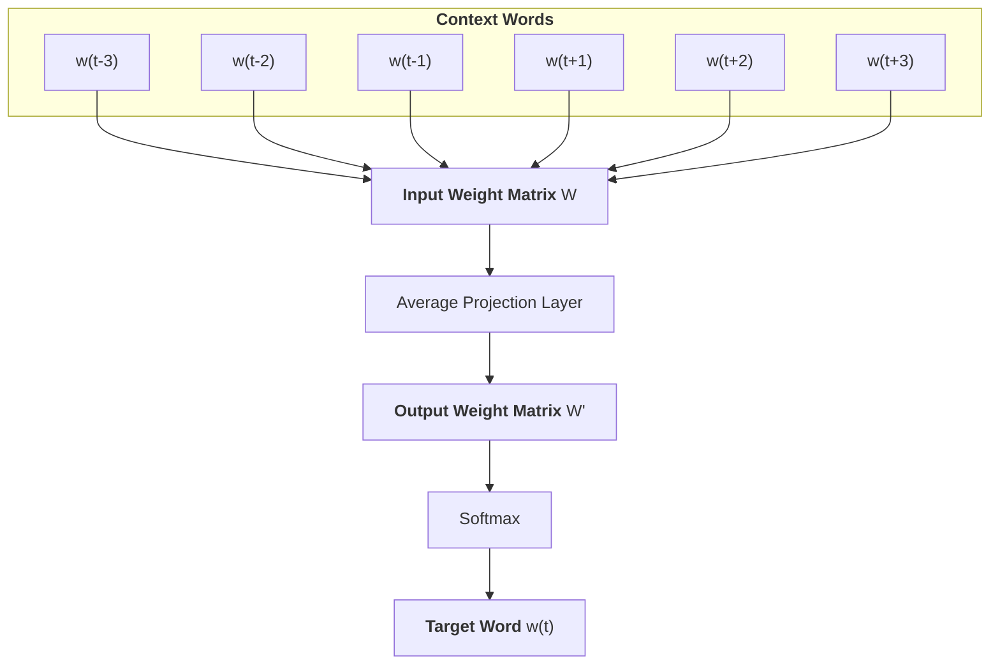

# Word Vectors

The goal is to generate static embeddings from a Viquipèdia (Catalan Wikipedia) corpus.

## Diagram



## Process

A sample of the training data looks like this:
```txt
El Palau Cívic és un edifici del centre històric de l &apos; Alguer catalogat com a Bé Cultural per la Regió Autònoma de Sardenya . Hi ha les oficines de turisme , activitats lúdiques com el Club de Mariners i és la seu de l &apos; Arxiu Històric Municipal .
```

The first step is to preprocess the corpus. Each line in the file is divided into words (with punctuation removed). A vocabulary of the corpus is built, which allows mapping each word to a random index that will be the input to our model. It also allows restricting the amount of words that we keep based on number of appearances in the corpus. This might generate OOV (Out Of Vocabulary) words if these only appeared a few times. This is done because the model struggles to generate meaningful embeddings for words that appear only a few times in the corpus. 

After the preprocessing step, we will end up with training pairs comprised of 6 tokens (the index of a specific word mapped by the Vocabulary) and a target token which is the middle word. Remember that we are doing non-causal language modeling, thus the goal is to predict the central word of a window of N words.
